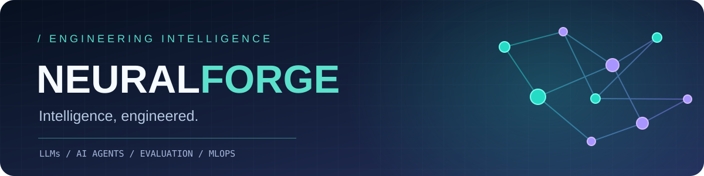
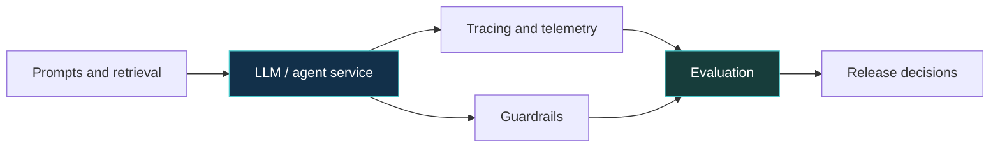

  

  

  
  
  

## Overview

**NeuralForge** is a professional engineering identity focused on **production AI systems**. My background covers more than **10 years** of Python/backend and ML-platform development, including LLM tracing, guardrails, RAG evaluation, model serving, and distributed data pipelines.

I build AI features with the infrastructure they need to be useful in production: **evaluation, monitoring, robust APIs, scalable data processing, and traceable decisions**.

  <table>
    <tr>
      <td align="center" width="33%"><b>50M+</b> daily monitoring events in platform pipelines</td>
      <td align="center" width="33%"><b>&lt;100 ms</b> guardrail scoring p95 after optimization</td>
      <td align="center" width="33%"><b>~40%</b> reduction in large batch-scoring runtimes</td>
    </tr>
  </table>

> The figures above describe selected experience from previous engineering work; they are not measurements of this GitHub profile.

---

## Core expertise

| AI & model engineering | Application & platform engineering |
| :--- | :--- |
| **LLMs:** OpenAI, Anthropic Claude, Hugging Face | **Backend:** Python, FastAPI, REST APIs |
| **Agent frameworks:** LangChain, LangGraph, tool calling | **Streaming:** Kafka, Spark, ClickHouse |
| **RAG:** embeddings, pgvector, Pinecone | **Datastores:** PostgreSQL, Redis |
| **ML:** PyTorch, Transformers, scikit-learn, XGBoost | **Cloud:** AWS, GCP, Azure |
| **Evaluation:** faithfulness, groundedness, guardrails | **Delivery:** Docker, Kubernetes, Helm, GitHub Actions |
| **MLOps:** MLflow, drift detection, SHAP | **Telemetry:** OpenTelemetry, observability pipelines |

### Frameworks & languages

  
  
  
  
  
  
  

## Tooling

<table align="center">
  <tr>
    <td align="center" width="20%"> Docker</td>
    <td align="center" width="20%"> Kubernetes</td>
    <td align="center" width="20%"> Kafka</td>
    <td align="center" width="20%"> MLflow</td>
    <td align="center" width="20%"> OpenTelemetry</td>
  </tr>
</table>

---

## Systems I build

<table>
<tr>
  <td width="50%" valign="top">
    <h3>🔭 LLM observability</h3>
    Prompt, response, tool-call, and trace ingestion with monitoring dashboards, provider-level cost insights, and production debugging.
      <code>FastAPI · OpenTelemetry · Kafka · ClickHouse</code>
  </td>
  <td width="50%" valign="top">
    <h3>🛡️ Evaluation & guardrails</h3>
    Hallucination, PII, and toxicity scoring with release-time evaluation for faithfulness and groundedness.
      <code>PyTorch · pytest · Redis · pgvector</code>
  </td>
</tr>
<tr>
  <td width="50%" valign="top">
    <h3>🧠 RAG & agent workflows</h3>
    Retrieval-backed applications, multi-step agent traces, and tool-enabled internal assistants with observable execution.
      <code>LangGraph · OpenAI · Pinecone · FastAPI</code>
  </td>
  <td width="50%" valign="top">
    <h3>⚙️ MLOps & model serving</h3>
    Batch scoring, model registries, drift detection, and Kubernetes-backed inference services.
      <code>MLflow · Spark · Helm · vLLM</code>
  </td>
</tr>
</table>

*These cards describe areas of professional experience, not links to public repositories.*

## A production-minded AI workflow

## Engineering principles

**Measure behavior. Validate outputs. Trace decisions. Automate the repeatable work.**

<!-- Optional GitHub-only stats, after this handle exists:

-->

NEURALFORGE / Intelligence, engineered.

